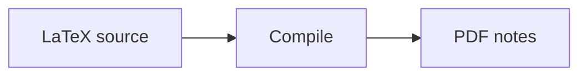

# Contributing

Thank you for helping maintain the Westlake Noter website.
Contributions can improve the course index, fix links, refine the interface,
or add tools when they are ready.

## Scope

- Put course descriptions, repository links, and reading instructions in the
  website's course pages, not in the project README.
- Keep website text, page titles, and navigation labels in English.
- Link to original course repositories instead of copying their contents here.
  Submit corrections to the lecture notes in the relevant source repository.
- Include only public course materials. Do not publish private repositories,
  credentials, or member information.
- Preserve existing page URLs when reorganizing files. Use an explicit `slug`
  when needed, and update any affected internal links.

## Development Setup

Use Node.js 22, matching CI. Create a branch for your changes; fork the repository
first if you do not have write access.

```sh
npm ci
npm start
```

Open `http://localhost:3000/notes-index/`.

## Repository Layout

```text
docs/
  notes/
    index.md
    <subject>/
      _category_.json
      index.md
      <course>.md
  tools/
    index.md
src/
  components/
  css/custom.css
  theme/
sidebars.js
docusaurus.config.js
.github/workflows/pages.yml
```

`sidebars.js` scans the Notes and Tools directories automatically. You do not
need to register individual pages there.

## Add or Update a Course

Create one Markdown page per course-note repository in
`docs/notes/<subject>/`. Use a descriptive, lowercase, hyphenated filename.

```md
---
title: New Course
description: A short summary of the course materials.
sidebar_position: 8
---

# New Course

Briefly describe the materials and their scope.

- Repository: [Repository name](https://github.com/OWNER/REPOSITORY)
- Contents: topics or chapters covered.
- Reading: where to find PDFs, releases, or build instructions.
```

Replace the example title, links, and content with verified information.
Do not claim that PDFs or releases exist without checking.
Use `description` for the directory card summary; `sidebar_label` is optional
when it should differ from the page title.

`sidebar_position` controls ordering within a subject. Omit it to use the default
ordering, or choose a position consistent with neighboring pages.

The sidebar and the existing subject directory update automatically. Do not
add a duplicate course list to the README or subject index.

## Add a Subject

Create `docs/notes/<subject>/` with `_category_.json`, an `index.md`, and its
course pages. Category metadata sets the display name and order:

```json
{
  "label": "Physics",
  "position": 4
}
```

Use an index page for the subject introduction and automatic course directory:

```md
---
title: Physics
slug: /notes/physics
---

# Physics

A brief introduction to this subject's materials.

<AutoDocIndex />
```

The home page uses `<AutoDocIndex subjects />` to discover subject categories.
There is no separate home-page list to maintain.

## Tools and MDX

Tools has its own automatically generated sidebar under `docs/tools/`.
It currently contains only a placeholder. When adding the first real tool,
update that introduction accordingly.

Use `.mdx` for interactive pages. Keep reusable React components in
`src/components/` and import them into the page:

```mdx
import MyTool from '@site/src/components/MyTool';

<MyTool />
```

The component must exist at the imported path. Browser APIs such as `window`
and `document` must not be accessed during server rendering. Access them from
effects or event handlers, or render browser-only components through
`@docusaurus/BrowserOnly`.

`Tabs` and `TabItem` are globally available without imports:

```mdx
<Tabs>
  <TabItem value="source" label="Source" default>
    LaTeX source files.
  </TabItem>
  <TabItem value="pdf" label="PDF">
    Compiled lecture notes.
  </TabItem>
</Tabs>
```

## Math and Diagrams

KaTeX supports inline math with `$...$` and display math with `$$...$$`:

```md
For $f(x) = x^2$, the derivative is $f'(x) = 2x$.

$$
\int_0^1 x^2\,dx = \frac{1}{3}
$$
```

KaTeX styles and fonts are bundled locally; an external CDN is not required.
The `katex` override in `package.json` keeps the math plugins and Mermaid on
the same patched version. When upgrading these dependencies, test both formulas
and diagrams.

Use a `mermaid` code block for diagrams:

````md

````

Mermaid colors follow the website's light/dark mode.

## Edit Links and Update Dates

Each page's **Edit this page** link points to its source file in this repository.
**Last updated** reflects that file's Git history, not activity in the linked
course repository. Newly added files need a commit before a real Git update
date can be inferred.

Development mode may show a simulated date. Production builds use the actual
commit date, and CI fetches the full Git history for this purpose.

## Checks Before a Pull Request

Run:

```sh
npm run build
git diff --check
```

The build checks internal document links. Also check external repository,
release, and PDF links manually.

- Confirm the page appears in the correct section and directory.
- Check desktop and narrow mobile layouts for wrapping and overflow.
- Check light and dark modes when changing styles, formulas, or diagrams.
- Test keyboard navigation and state changes for interactive components.
- Keep generated output, `node_modules/`, credentials, and temporary test pages
  out of the pull request.

## Submit Changes

Open a pull request against `main` with a short description of the change and
the checks you ran. Include screenshots for visible interface changes and
mention any changed URLs. Keep unrelated changes in separate pull requests.

The GitHub Actions workflow checks production builds on pull requests and
deploys updates to `main`. Changes limited to root Markdown files, such as
`README.md` and `CONTRIBUTING.md`, skip this workflow on both pushes and pull
requests. Site pages in `docs/` still require a full Docusaurus build, even for
text-only edits. A commit that changes both repository documentation and site
files still triggers the workflow. Manual runs remain available through
**Actions > Build and Deploy Pages > Run workflow**.

If branch protection later requires the build check, revisit these path filters:
a skipped workflow does not report a successful required check.

For root-documentation-only changes, check the Markdown links and code blocks
and run `git diff --check`; a local site build is optional.

Maintainers configure **Settings > Pages > Source**
as **GitHub Actions**. Site address settings live in `docusaurus.config.js`;
deployment configuration lives in `.github/workflows/pages.yml`.
