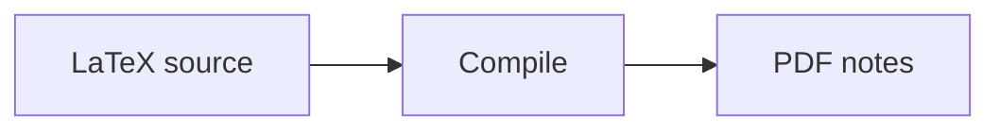

# Westlake Noter 课程笔记索引 / Course Notes Index

这里仅整理组织内已有的课程笔记，具体内容与编译方式见各仓库 README。

An index of the organization's existing course notes. See each repository's README for details and build instructions.

## 课程笔记 / Course Notes

| 课程 / Course | 笔记仓库 / Repository | 内容与维护情况 / Contents & Maintenance |
| :--- | :--- | :--- |
| 代数与分析基础 / Fundamental Algebra and Analysis | [FAA-lecture-notes-2025fall-2026spring](https://github.com/westlake-noter/FAA-lecture-notes-2025fall-2026spring) | **2025fall–2026spring**：第一、二部分 LaTeX 讲义源码归档，后续以勘误和小范围修正为主。/ Parts I & II source archive; occasional corrections. |
| 常微分方程 / Ordinary Differential Equations | [Ordinary-Differential-Equations](https://github.com/westlake-noter/Ordinary-Differential-Equations) | 按章节整理的 LaTeX 课程笔记，随新增章节与勘误更新。/ Chapter-based LaTeX notes; updated with new chapters and corrections. |
| 测度论与实分析 / Measure Theory and Real Analysis | [Measure-Theory-and-Real-Analysis](https://github.com/westlake-noter/Measure-Theory-and-Real-Analysis) | 按章节整理的 LaTeX 课程笔记，随新增章节与勘误更新。/ Chapter-based LaTeX notes; updated with new chapters and corrections. |
| 概率论 / Probability Theory | [Probability-Theory](https://github.com/westlake-noter/Probability-Theory) | 按章节整理的 LaTeX 课程笔记，随新增笔记与勘误更新。/ Chapter-based LaTeX notes; updated with new notes and corrections. |
| 普通化学 / General Chemistry | [General-Chemistry](https://github.com/JiamingShi-JsPhys/chem-notes) | 第一到三章（化学热力学、电化学、化学动力学）完成。/ Chapters 1–3 (thermodynamics, electrochemistry, kinetics) are complete. |
| 微积分 / Calculus | [Calculus-lecture-notes-2025fall-2026spring](https://github.com/qwerasdasd1/Calculus-notes) | **2025fall–2026spring**：微积分 A 类（上、下）LaTeX 讲义，附 PDF。/ Track A single-variable and multivariable calculus notes; LaTeX sources and PDF available. |
| 线性代数 / Linear Algebra | [Linear-Algebra-lecture-notes-2025fall-2026spring](https://github.com/qwerasdasd1/Linear-Algebra-notes) | **2025fall–2026spring**：线性代数 A 类（上、下） LaTeX 讲义，附 PDF。/ Track A LaTeX lecture notes, with PDF. |
| 偏微分方程 / Partial Differential Equations | [PDE-lecture-notes-2026fall](https://github.com/qwerasdasd1/PDE-notes) | **2026fall**：提供 LaTeX 源码与 PDF，持续整理中。/ LaTeX sources and PDF available; work in progress. |

## 阅读入口 / Reading

- 各仓库提供 LaTeX 源码；PDF 的获取方式以各仓库说明为准。代数与分析基础的 PDF 包请查看其 [Releases](https://github.com/westlake-noter/FAA-lecture-notes-2025fall-2026spring/releases)。

Repositories provide LaTeX sources; consult their READMEs for PDF availability. For Fundamental Algebra and Analysis PDF bundles, check its Releases page.

## Docusaurus 站点

The site currently uses English for all interface text and course summaries,
with GitHub-inspired light and dark styles in `src/css/custom.css`.
The color mode follows the system on first visit. The toggle switches only
between light and dark, and remembers the manual preference.
The top navigation separates Course Notes and Tools. Both sidebars are generated
from their respective directories; adding a Markdown page does not require
editing `sidebars.js`. `docs/tools/index.md` is the Tools placeholder.

站点地址：<https://westlake-noter.github.io/notes-index/>。

本地开发需要 Node.js 22：

```sh
npm ci
npm start
```

本地地址为 `http://localhost:3000/notes-index/`。生产构建和预览：

```sh
npm run build
npm run serve
```

### 内容维护

- `docs/notes/index.md`：站点首页与学科入口。
- `docs/notes/<学科>/index.md`：学科介绍页，自动作为该分类的入口。
- `docs/notes/<学科>/_category_.json`：分类名称与顺序。
- `docs/notes/<学科>/<仓库>.md`：每个课程仓库独立的介绍页面。
- `docs/tools/index.md`：Tools 入口；后续工具页面放入 `docs/tools/`。
- `sidebars.js`：仅指定 Notes 和 Tools 的自动扫描目录，无需逐篇登记。

添加课程或工具时，只需在对应目录新建 `.md`，侧边栏会自动收录。
页面标题和可选的排序序号放在 frontmatter 中，例如：

```md
---
title: New Course
sidebar_position: 8
---

# New Course

Course summary and repository link.
```

未指定 `sidebar_position` 的页面使用默认排序。新增学科时，新建目录即可；
可添加 `_category_.json` 设置英文分类名称和顺序，例如：

```json
{
  "label": "Physics",
  "position": 4
}
```

分类介绍页使用 `index.md`。现有入口页通过 `slug` 保留原来的 URL；
普通课程文件名不变时，链接也不变。

首页学科目录与各学科课程目录通过 `<AutoDocIndex />` 自动生成，
使用侧边栏中的标题、顺序与文档摘要；新增课程或学科无需再更新网页目录。
可在课程 frontmatter 设置 `description` 来提供卡片摘要。
本 README 的课程表仍为手写内容；课程页需写明仓库链接、资料范围和 PDF 获取方式。
只收录课程资料，不发布私有仓库或成员数据。

### 编辑入口与更新时间

每篇页面底部提供 **Edit this page**，指向本仓库中对应的源文件。
**Last updated** 来自该文件的 Git 提交记录，不代表外部课程仓库的更新时间。
部署工作流拉取完整 Git 历史，以保证时间准确；新增文件提交后才有真实更新时间。
`npm start` 的开发模式可能显示模拟日期，生产构建与部署使用真实提交日期。

### MDX 与交互组件

页面支持 MDX，可导入 `src/components/` 中的 React 组件；交互工具推荐使用 `.mdx`。
`Tabs` 与 `TabItem` 已全局注册，无需逐页导入：

```mdx
<Tabs>
  <TabItem value="source" label="Source" default>
    LaTeX source files.
  </TabItem>
  <TabItem value="pdf" label="PDF">
    Compiled lecture notes.
  </TabItem>
</Tabs>
```

需要状态时，在 `src/components/` 编写普通 React 组件，再从页面导入：

```mdx
import MyTool from '@site/src/components/MyTool';

<MyTool />
```

组件只能在浏览器中访问 `window`、`document` 等 API，应放在 effect 或事件处理器中，
或用 `@docusaurus/BrowserOnly` 包裹。Tools 当前仍保留为空，未添加演示工具。

### 数学公式与 Mermaid

数学公式使用本地打包的 KaTeX 样式与字体，不依赖外部 CDN。
`package.json` 的 KaTeX override 将数学插件与 Mermaid 统一到已修复安全问题的版本；
升级相关依赖时需一起验证公式与图表渲染。
行内公式用 `$...$`，独立公式用 `$$...$$`：

```md
For $f(x) = x^2$, the derivative is $f'(x) = 2x$.

$$
\int_0^1 x^2\,dx = \frac{1}{3}
$$
```

Mermaid 使用 `mermaid` 代码块，配色跟随站点明暗模式：

````md

````

### GitHub Pages

`.github/workflows/pages.yml` 会在 PR 上验证构建，在 `main` 更新后部署。
仓库 **Settings → Pages → Source** 应选择 **GitHub Actions**。
站点的 `url` 和 `baseUrl` 已按本仓库地址配置。
